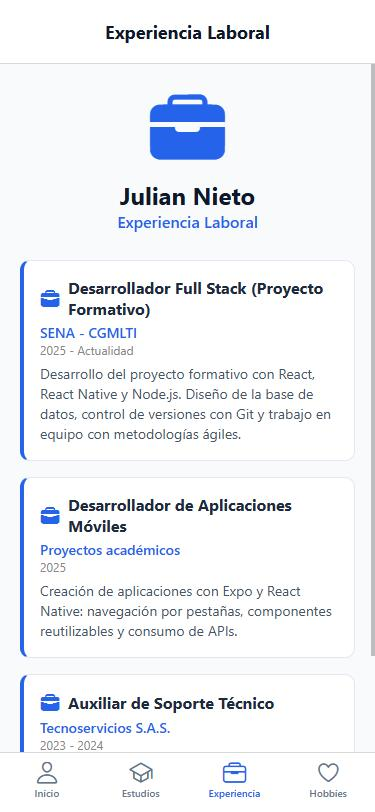

# Hoja de Vida – React Native (Expo)

Aplicación móvil de hoja de vida con 4 pantallas navegables mediante un menú inferior con pestañas (Bottom Tabs) e íconos. Taller práctico **Creando componentes y navegación por pestañas en React Native** del programa Análisis y Desarrollo de Software (ADSO), SENA – CGMLTI.

**Aprendiz:** Julian Nieto
**Instructor:** Jhonny Orlando Guerrero Matabanchoy

## Pantallas

| Inicio | Estudios | Experiencia | Hobbies |
| --- | --- | --- | --- |
|  |  |  |  |

## Estructura

```
src/
├── app/
│   ├── _layout.tsx        Menú inferior con pestañas e íconos
│   ├── index.tsx          Pantalla 1: Datos Personales
│   ├── estudios.tsx       Pantalla 2: Formación Académica
│   ├── experiencia.tsx    Pantalla 3: Experiencia Laboral
│   └── hobbies.tsx        Pantalla 4: Intereses / Hobbies
├── components/
│   ├── MiBoton.tsx            Botón reutilizable (texto, ícono, color, acción)
│   ├── TarjetaEstudio.tsx     Resalta el estudio si enCurso es true
│   ├── TarjetaExperiencia.tsx
│   └── TarjetaHobby.tsx       Al tocarla muestra los detalles (Alert)
└── utils/
    └── alerta.ts          Alert.alert en el celular y window.alert/confirm en web
```

## Librerías

Todas se instalaron con `npx expo install`, que escoge la versión compatible con el SDK de Expo del proyecto.

| Librería | Para qué sirve |
| --- | --- |
| `expo-router` | Navegación basada en archivos: cada archivo de `src/app` es una pantalla y `_layout.tsx` define el navegador (aquí, `Tabs`). |
| `react-native-safe-area-context` | Calcula las zonas seguras (notch, barra de estado, barra de gestos) para que el contenido no quede tapado. |
| `react-native-screens` | Usa las vistas nativas de cada sistema para las pantallas, lo que mejora el rendimiento y la memoria. |
| `expo-linking` | Maneja los enlaces profundos (`hojadevida://`) y abre URLs externas. |
| `expo-constants` | Expone la configuración de `app.json` y datos del dispositivo en tiempo de ejecución. expo-router lo usa internamente. |
| `expo-status-bar` | Controla el estilo de la barra de estado (aquí, `dark`). |
| `@expo/vector-icons` | Íconos (Ionicons) para las pestañas, los botones y las tarjetas. |
| `expo-font` | Carga las fuentes de los íconos. Es dependencia obligatoria de `@expo/vector-icons` (lo detectó `npx expo-doctor`). |
| `react-native-web`, `react-dom` | Permiten ejecutar y probar la app en el navegador. |

## Cómo ejecutar

```bash
npm install
npx expo start
```

Escanea el código QR con la app **Expo Go** en el celular. Para verla en el navegador, presiona `w` o ejecuta `npx expo start --web`.

## Reto obligatorio

1. **Insignia "En Curso":** en `TarjetaEstudio` la etiqueta es una cápsula redondeada con fondo morado y texto blanco.
2. **Interactividad en los botones:** correo, teléfono, LinkedIn, Facebook y GitHub muestran su dato con `Alert.alert` y dan la opción de abrirlo con `Linking.openURL`.
3. **Interactividad en los hobbies:** al tocar una tarjeta de hobby aparece una alerta con detalles del pasatiempo.

## Lista de verificación

- [x] La pantalla de inicio tiene ícono y datos personales.
- [x] Los estudios "En Curso" se distinguen por su color de los finalizados.
- [x] El menú inferior permite cambiar entre las 4 pestañas.
- [x] Cada pantalla tiene su propio ícono en el menú inferior.
- [x] El proyecto compila sin errores (`npx tsc --noEmit`, `npx expo export` y `npx expo-doctor` 20/20).
